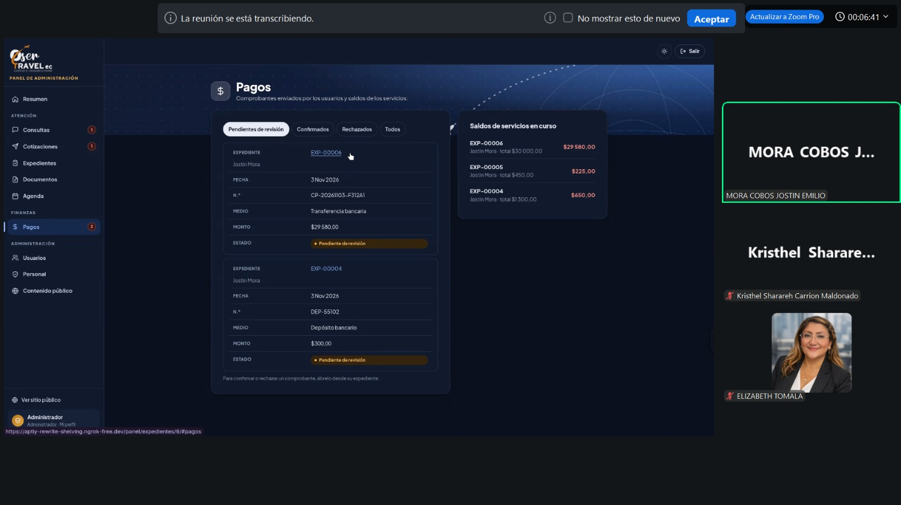

# Levantamiento de requerimientos y metodología de trabajo

## Identificación de necesidades y revisión con la clienta
Como equipo DeepMinders, conformado por Anthony Walter Paredes Vega, Kristhel Sharareh Carrión Maldonado, Jostin Emilio Mora Cobos y Xavier Andrés Murillo Panchana, realizamos una entrevista inicial con la clienta de OSERTRAVEL EC para conocer su forma de trabajo, las dificultades de la agencia y el alcance esperado de OserVia.

A partir de las reuniones pudimos identificar que la clienta organizaba los registros y documentos de sus usuarios mediante carpetas y atendía gran parte de las solicitudes por WhatsApp. Esta distribución dificultaba consultar la información de cada servicio y mantener separados los documentos y las conversaciones de distintos usuarios. Con esta información formulamos los requerimientos para centralizar la atención y el seguimiento.

Posteriormente, realizamos una reunión por Zoom de aproximadamente tres horas para explicar los requerimientos funcionales y no funcionales, resolver dudas y revisar sus prioridades. Implementamos la clasificación MoSCoW: Must para lo indispensable, Should para lo importante pero postergable, Could para lo complementario y
Won’t para lo excluido de la primera versión. Explicamos esta clasificación a la clienta, quien manifestó su acuerdo con los requerimientos y las prioridades presentadas.

En otra reunión por Zoom, también de aproximadamente tres horas, mostramos el funcionamiento del prototipo. La clienta planteó dos consultas sobre funciones ya contempladas, que aclaramos durante la demostración. Nos expresó que la solución respondía a sus expectativas y facilitaría su trabajo. También valoró el asistente
virtual, el acceso a WhatsApp, el video de orientación y la adaptación de la interfaz a distintos tamaños de pantalla.

Durante esta demostración nos solicitó incorporar hospedaje. Implementamos esta sección y actualizamos los requerimientos de consulta de ofertas, solicitudes de cotización y creación de expedientes. Posteriormente, la clienta revisó y aprobó la versión actualizada. También conversamos sobre los referidores y aclaramos
que la gestión de recomendaciones y comisiones quedaba fuera de la primera versión, con prioridad Won’t.

## Organización y proceso de trabajo
Nos organizamos mediante la distribución de tareas y reuniones para revisar avances. Anthony Paredes y Kristhel Carrion participaron principalmente en la formulación y revisión de los requerimientos funcionales y no funcionales, ademas de la elaboración del documento en LaTeX. Jostin Mora y Xavier Murillo participaron principalmente en la implementación de la aplicación web a partir de los requerimientos aprobados. Además, realizamos pruebas para revisar su funcionamiento y su correspondencia con lo especificado.

Nuestro proceso comprendió la identificación de necesidades, la formulación y priorización de requerimientos, su revisión con la clienta, la implementación y las pruebas del prototipo y la incorporación de sus observaciones. La solicitud de hospedaje nos permitió ajustar tanto el aplicativo como la especificación.

## Evidencias y documentación
Elaboramos este registro a partir de lo que la clienta nos menciono en la reunión por Zoom. 
Adjuntamos por medio de una captura de pantalla una de las reuniones que tuvimos con nuestro cliente, donde nuestro compañero Jostin le estaba explicando al cliente como se visualiza la gestión de pagos como rol de administrador.

- [Aplicativo OserVia](https://oservia.vercel.app/)
- [Sección de hospedaje](https://oservia.vercel.app/hospedaje/)
- [Repositorio del proyecto](https://github.com/Jostin798M/OserVia)